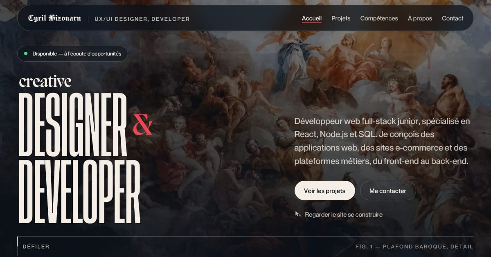

<div align="center">

# Portfolio — Cyril Bizouarn

**Développeur web full-stack** · Angular 21 · TypeScript · SCSS

[](https://the-cyril5555.github.io/portfolio/)
[](https://angular.dev)
[](https://www.typescriptlang.org/)



</div>

## Le concept : un catalogue d'exposition

Chaque projet est présenté comme une œuvre accrochée dans un musée : une peinture classique du domaine public, un cartel (artiste, titre, date), un accrochage asymétrique sur une grille de 12 colonnes. Papier crème, titres de section en gothique, lettrage d'affiche condensé, un seul accent rouge.

Bouton **« Regarder le site se construire »** (dans le hero, à la souris) : la page s'efface et une nuée de curseurs façon Figma la reconstruit sous vos yeux. Lien partageable : [`/portfolio/?swarm`](https://the-cyril5555.github.io/portfolio/?swarm).

## Sections

| Section | Contenu |
| --- | --- |
| Hero | Lettrage « Designer & Developer », pastille de disponibilité, accès aux projets / au contact, effet Swarm |
| Projets | 6 réalisations (Shadow Hunters, boutique e-commerce, Proflex, ce portfolio, SQWK, Wiki) + lien GitHub |
| Compétences | Front-end, back-end & données, CMS & outils — icônes locales |
| À propos | Bio, puis « Parcours » : formation et expériences sur une même frise |
| Contact | Adresse e-mail (copie en un clic), GitHub, LinkedIn |

## Technique

- **Angular 21** sans zone.js (zoneless), composants standalone, `OnPush`, signaux, control flow `@if` / `@for`.
- **Aucune bibliothèque d'animation** : apparitions au scroll en CSS (une directive `appReveal` et un seul `IntersectionObserver`), parallaxe en CSS *scroll-driven*. Tout est coupé quand le système demande moins d'animations.
- **Nav en verre CSS** (`backdrop-filter`) qui passe en clair ou en sombre selon la section survolée.
- **Design tokens** : couleurs, typographie, espacements, grille et durées dans `src/styles/_tokens.scss` ; les composants n'utilisent que ces variables.
- **Performance** : bundle initial ≈ 213 Ko (≈ 60 Ko compressés), polices woff2 auto-hébergées, peintures WebP responsives (`srcset`, chargement différé), script Swarm chargé seulement au survol / clic du bouton.
- **Accessibilité** : un seul `h1`, landmarks, lien d'évitement, focus visible sur fond clair comme sombre, menu mobile au clavier (piège de focus, Échap), contrastes mesurés ≥ 4,5:1, `prefers-reduced-motion` respecté.
- **Tests** : Vitest (`ng test`), exécutés en CI avant chaque déploiement.

```
src/
├── styles/                 # tokens, polices, socle, typographie, classes partagées
└── app/
    ├── components/
    │   ├── navigation/     # barre de navigation + menu mobile
    │   ├── sections/       # hero, portfolio (projets), skills, about, contact
    │   ├── layout/         # pied de page
    │   └── shared/, ui/    # frise du parcours, icônes
    ├── data/               # contenus (projets, technos, parcours, contact)
    ├── directives/         # appReveal
    └── services/           # scroll (ancres + section active), reveal, swarm, seo
public/
├── assets/images/paintings # peintures WebP générées (npm run optimize-images)
├── assets/svg/tech-icons   # icônes devicon (MIT)
└── swarm-cursors.js        # moteur de l'effet Swarm (tiers, voir Crédits)
scripts/
├── optimize-images.mjs     # génère les WebP depuis scripts/originals/
└── originals/              # peintures sources en haute définition
```

## Développement

Node `^20.19`, `^22.12` ou `≥ 24`.

```bash
npm install
```

```bash
npm start            # http://localhost:4200
```

```bash
npm test -- --watch=false
```

```bash
npm run build        # dist/portfolio-angular/browser (+ minification de swarm-cursors.js)
```

```bash
npm run optimize-images
```

Le déploiement sur GitHub Pages est automatique à chaque push sur `main` (`.github/workflows/deploy.yml` : tests, build avec `--base-href=/portfolio/`, `404.html`, date du sitemap). Tous les chemins d'assets sont relatifs : aucun post-traitement n'est nécessaire.

## Crédits

- **Effet Swarm** : design et animation de [Joel Califa](https://califa.github.io/swarm-site/), via [harshit403-pixel/reveal-cursors](https://github.com/harshit403-pixel/reveal-cursors) (lui-même issu de l'extension Swarm Rebuild). L'en-tête de `public/swarm-cursors.js` garde ce crédit et liste les adaptations locales (traduction française, accessibilité du HUD, capture du `<picture>`). L'original n'ayant pas de licence, son usage public suppose l'accord de son auteur.
- **Peintures** (domaine public) : Arnold Böcklin, Edmund Blair Leighton, Jan Matejko, Alexandre Cabanel, John Martin, Adriaen van Utrecht, Willem van de Velde le Jeune ; plafond baroque du hero et du contact.
- **Icônes** : [devicon](https://devicon.dev) (MIT).

## Contact

[cyril.bizouarn@gmail.com](mailto:cyril.bizouarn@gmail.com) · [GitHub](https://github.com/The-Cyril5555) · [LinkedIn](https://linkedin.com/in/cyril-bizouarn)
